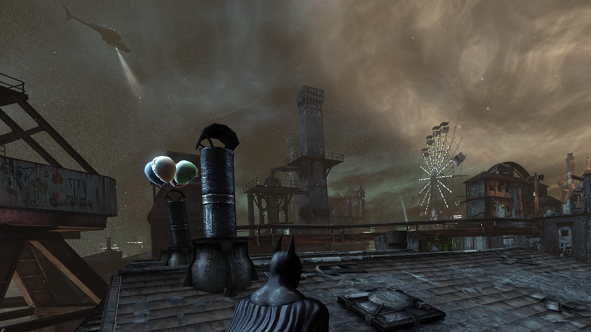
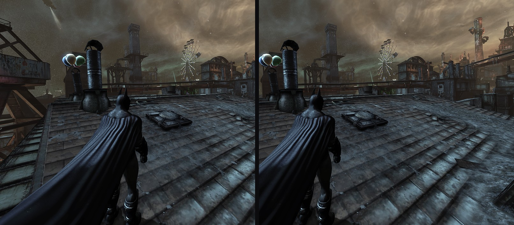

  

# Batman City VR

Batman: Arkham City in PC VR, with per-eye DLSS, an AFW speed mode, and OpenXR for Virtual Desktop and SteamVR. The
game draws both eyes itself, every frame, from the same moment (native stereo), so depth is correct and nothing lags
behind when the camera swings.

## What you get

- **DLSS for each eye** (NVIDIA RTX graphics cards): each eye is drawn smaller and upscaled by NVIDIA's DLSS, which
  also gives clean anti-aliasing. Choose the quality in the VR menu.
- **AFW (alternate frame warping)**, a choice in the VR menu beside full native stereo: the game draws one eye per
  frame and the other eye is built from that same frame, so both eyes still show the same moment. More frames per
  second on slower PCs.
- **OpenXR, with Virtual Desktop and SteamVR**: runs on your PC VR software's own OpenXR runtime (no extra layers or
  injectors). A separate SteamVR shortcut starts the game through SteamVR without changing your PC's VR settings.
- **Native stereo 3D** with full head tracking (look around and lean in), on the game's own third-person camera.

  

- **HUD on a panel in front of you**; the grapple reticle sits on its target, at the target's depth.
- **Aim with your head**: hold the left trigger and the batclaw, batarangs and other gadgets go where you look, in third
  and first person. The aim reticle floats at the HUD's distance in the direction you aim.
- **Grapple points where you look**: look up or around with your head and the game's grapple markers appear on what
  you can reach, without turning the camera with the stick. Your view stays where the stick puts it. With "also left /
  right" (on by default) the stick walks Batman where you look; untick it to keep looking left / right to yourself.
- **Enemy info and detective-mode details point at their targets**: the labels the game hangs on people (enemy
  info, vital signs in detective mode) sit on the person they belong to, in both eyes.
- **Detective mode drawn once for both eyes**: its vignette, honeycomb and the moving stripes in the outlines are
  shared by both eyes, so they fuse into one picture instead of a frame around each eye.
- **Adjustable third-person camera position**: move the camera left / right, up / down, back / forward in the VR menu.
- **Menus, the map and loading screens** on a large screen in the room, with the game's bat transitions.
- **An in-headset VR menu**: hold both thumbsticks down (or press F10). World scale, HUD size and distance, render
  size, frame rate, comfort options, and more. Settings are saved.
- **Higher-resolution loading screens and opening logos.**
- **A first-person view** (optional, in the VR menu, or click both sticks twice quickly). Leaning back never takes the
  view into Batman's head.

## What you need

- **Batman: Arkham City - Game of the Year Edition** on Steam, on Windows 10 or 11.
- **A PC VR headset and the software you use for PC VR games** (for example Virtual Desktop, SteamVR or the Meta Quest
  Link app).
- **A gamepad.** Quest Touch controllers work through Virtual Desktop, which presents them as a gamepad.

Tested with: Quest 3 through Virtual Desktop, RTX 4070 Ti. A SteamVR launcher is included and was tested with SteamVR.

## Installing

1. Start the game once from Steam as normal, wait for the main menu, and quit (this makes the game's settings files).
2. Download `BatmanCityVR-ArkhamCity.zip` from [Releases](../../releases) and unpack it anywhere (7-Zip works).
   It is about 290 MB: most of that is the AI-upscaled loading-screen pictures (about 225 MB, 87 pictures at twice
   the game's resolution) and NVIDIA's DLSS library (about 60 MB). The mod itself is a few MB.
3. Double-click `Install-BatmanCityVR.bat`. If Windows SmartScreen appears: More info, then Run anyway. The installer
   puts everything into the game folder; you don't copy anything there yourself.
4. Start your PC VR software and make sure it is the active OpenXR runtime (Virtual Desktop and SteamVR each have a
   setting for this).
5. Start the game with the **Batman City VR** shortcut on your desktop. To play through SteamVR instead, use
   **Batman City VR (SteamVR)**.

The installer switches the game to DirectX 11 and turns motion blur and lens flares off, and saves your own
settings first.

## In the game

| | |
|---|---|
| VR menu | hold both thumbsticks down for half a second, or F10 |
| Recenter | hold the headset's menu / Meta button, or F12 |
| Save a picture of both eyes | the VR menu's capture button, or F2 |

## If something is wrong

| What you see | What to do |
|---|---|
| Nothing in the headset, the game plays on the monitor | Start your PC VR software before the game, make it the active OpenXR runtime, and start the game from the Batman City VR shortcut. |
| The installer stops: "the game has not made its settings yet" | Start the game once from Steam, wait for the main menu, quit, run the installer again. |
| Low frame rate | VR menu: lower the render size (VR resolution), or turn on DLSS or AFW. |
| The world feels too big or too small | VR menu: world scale. |

## Removing it

Run **Uninstall Batman City VR** from the Start menu (or `Uninstall-BatmanCityVR.bat` in the game folder). It
removes the mod and the shortcuts, puts your game settings back as they were, and deletes the mod's own VR settings
and logs (in `%LOCALAPPDATA%\Batman_City`).

## Credits

Built on [bioshock-vr](https://github.com/mohamad-balouza/bioshock-vr) (MIT), MinHook, Dear ImGui and the OpenXR SDK.
The per-eye DLSS method follows the [Luma Framework](https://github.com/Filoppi/Luma-Framework)'s Arkham Knight mod.
DLSS is NVIDIA's. Full list: [THIRD_PARTY_NOTICES.md](THIRD_PARTY_NOTICES.md).
The picture at the top is the game's own Steam store artwork, shown from Steam (Batman: Arkham City © Warner Bros.
Entertainment, Batman and all characters © DC); it is not part of this repository.

Batman: Arkham City © Warner Bros. Entertainment Inc. Batman and related characters are trademarks of DC Comics. This
is an unofficial fan mod and needs your own copy of the game.
